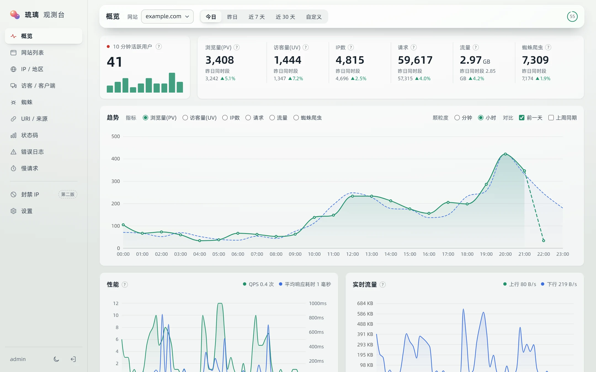
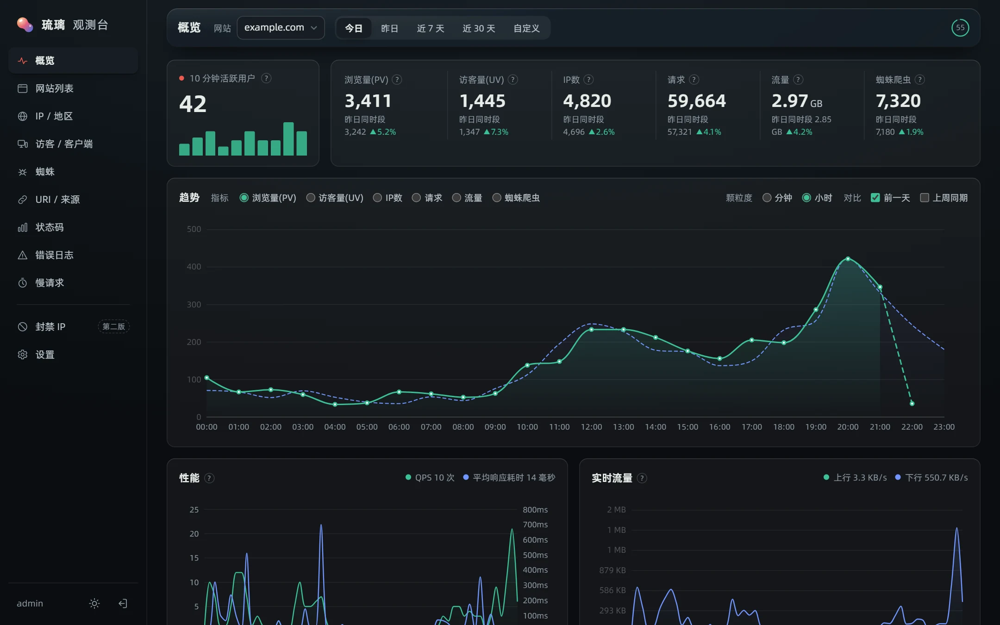
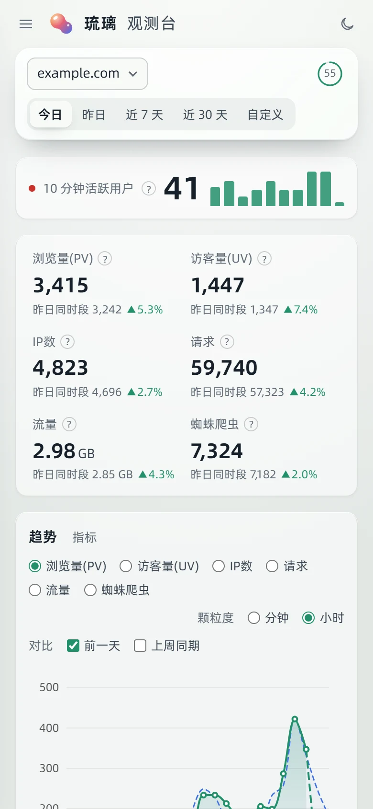
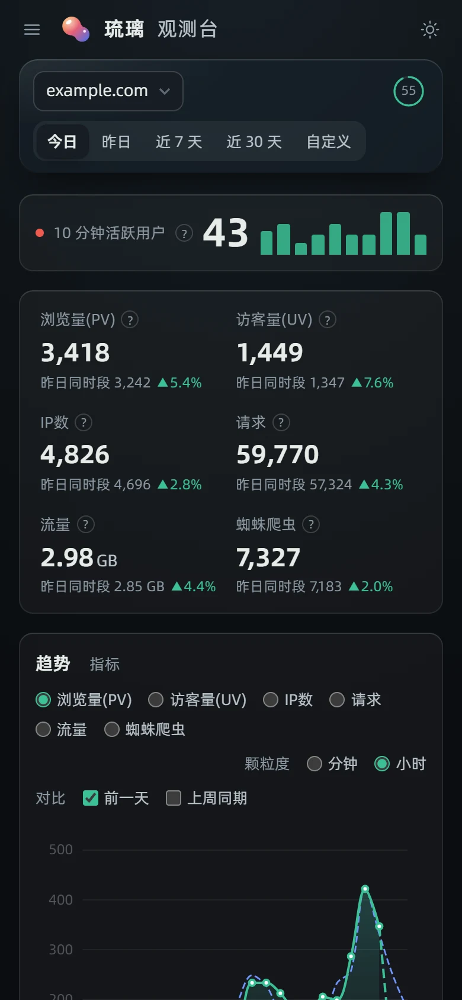
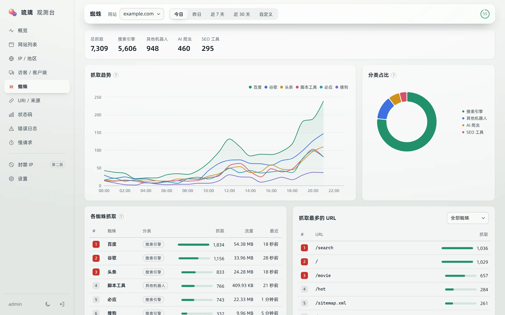
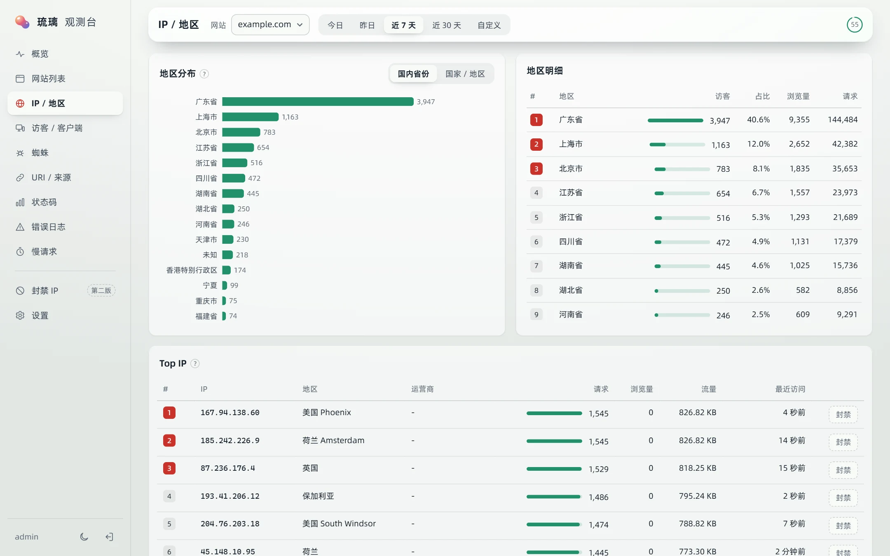
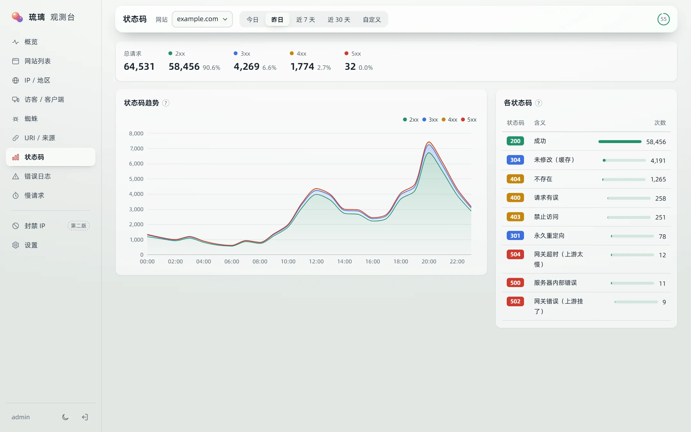
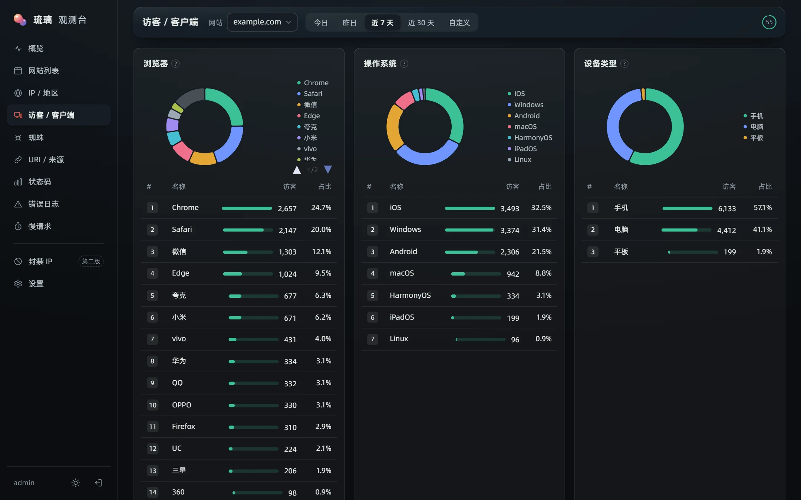

<div align="center">


# 琉璃观测台

**基于 Nginx / OpenResty 访问日志的网站监控报表 · 不往网页里加任何 JS**

体验对标宝塔面板的「网站监控报表」，但不依赖宝塔：一个 Go 程序、一个 SQLite 文件、一个 Docker 容器，<br>
日常内存 15 MB 左右，适合 1Panel 用户和任何自己管 Nginx 的站长。

[部署说明](部署说明.md) · [截图](#截图) · [指标口径](#指标口径) · [开发](#本地开发)

<sub>A self-hosted, log-based web analytics dashboard for Nginx / OpenResty — no tracking scripts, single Go binary + SQLite. UI in Chinese.</sub>

</div>



## 为什么做它

- **JS 统计**（百度统计、Clarity、Umami 之类）要改网页，而且统计不到蜘蛛、状态码、流量、耗时；被广告拦截插件一拦就少一截。
- **CDN 自带统计**延迟大、维度少。
- **宝塔的网站监控报表**很好用，但它绑在宝塔上。

琉璃观测台直接读服务器的访问日志：所有请求都在里面，网页一行不用改，数据只留在你自己的服务器上。

## 功能

- **概览**：10 分钟活跃访客、浏览量 / 访客 / IP / 请求 / 流量 / 蜘蛛，趋势图（按分钟 / 小时 / 天，可叠加前一天和上周同期），实时 QPS、响应耗时、上下行流量
- **网站列表**：多个站点今日数据一览；新网站自动发现，加上就统计
- **IP / 地区**：Top IP、国内到省、国外到国家（离线 IP 库 [ip2region](https://github.com/lionsoul2014/ip2region)，不联网查询）
- **访客 / 客户端**：浏览器（含微信、QQ、夸克等内置浏览器）、操作系统、设备类型
- **蜘蛛**：搜索引擎、AI 爬虫、SEO 工具、社交预览、脚本工具分类统计，抓取趋势和抓取最多的 URL
- **URI / 来源**：Top 页面、Top URI、来源域名、搜索引擎来源
- **状态码**：分布、趋势，点进去看明细
- **错误日志 / 慢请求**：4xx/5xx 和慢请求明细，可按 IP、URI、蜘蛛筛选
- **封禁 IP**：在 IP 列表、错误日志里一键封禁 / 解封，支持网段和到期自动解封、白名单，统计每个封禁 IP 被拦截的次数（生成 OpenResty deny 规则，通过 1Panel API 平滑重载）
- **一键接入**（1Panel）：通过 1Panel API 自动给 OpenResty 加上日志格式、把各网站切到 JSON 日志，新建的网站自动接入；每处修改都由 1Panel 执行 `nginx -t` 检查、失败自动回滚，可一键撤销
- 浅色 / 暗色两套主题，手机上也能看
- 单管理员登录（bcrypt、HttpOnly Cookie、登录限流），严格的 CSP 等安全响应头，日志目录只读挂载；容器根文件系统只读、去掉所有特权、以普通用户运行

## 截图

| 暗色 | 手机 |
|---|---|
|  |   |

| 蜘蛛 | IP / 地区 |
|---|---|
|  |  |

| 状态码 | 客户端 |
|---|---|
|  |  |

<details>
<summary>登录页</summary>


</details>

截图里是日志生成器造的示例数据。

## 快速开始

需要 Docker（含 compose 插件）。下面以 1Panel 为例，完整的图文步骤见 **[部署说明](部署说明.md)**。

**1. 让 Nginx / OpenResty 输出 JSON 日志**，在 `http {}` 里加：

```nginx
log_format liuli_json escape=json '{'
  '"t":"$time_iso8601","host":"$host","ip":"$remote_addr",'
  '"xff":"$http_x_forwarded_for","cfip":"$http_cf_connecting_ip","xri":"$http_x_real_ip",'
  '"m":"$request_method","uri":"$request_uri","st":$status,'
  '"bytes":$bytes_sent,"rl":$request_length,"rt":$request_time,"urt":"$upstream_response_time",'
  '"ref":"$http_referer","ua":"$http_user_agent","proto":"$server_protocol"'
'}';
```

再把各站点的 `access_log ... main;` 改成 `access_log ... liuli_json;`。默认的 combined / main 格式也能读，只是没有耗时数据。

> 用 1Panel 的话这一步可以跳过：部署后连上 1Panel API，在「设置 → OpenResty 接入」点一次「一键接入」，日志格式、各网站的 access_log 和封禁规则都会自动配好，以后新建的网站也会自动接入（见[部署说明第 7 步](部署说明.md#第-7-步连接-1panel-api一键接入推荐)）。

**2. 部署**

```bash
git clone https://github.com/AZCRONIN/liuli-observatory.git /opt/liuli-obs
cd /opt/liuli-obs && cp .env.example .env    # 填管理员密码、日志目录
docker compose -p liuli-obs up -d --build
```

**3. 反代**：把 `https://stats.example.com` 反代到 `http://127.0.0.1:8090`，打开、登录（用户名 `admin`）。

**升级**：`git pull && docker compose -p liuli-obs up -d --build`。

### 配置项（`.env`）

| 变量 | 默认 | 说明 |
|---|---|---|
| `LIULI_ADMIN_PASSWORD` | 空 | 首次启动时管理员密码，留空则随机生成并打印在日志里 |
| `LIULI_RESET_PASSWORD` | `0` | 设为 `1` 时用上面的密码重置管理员密码 |
| `LIULI_LOGS_DIR` | `/opt/1panel/www/sites` | 宿主机日志目录，结构为 `<域名>/log/access.log`，只读挂载到容器 `/logs` |
| `LIULI_SITES` | 空 | 首次启动导入的站点 `域名=容器内路径;…`，一般不用填（会自动发现） |
| `LIULI_PORT` | `8090` | 本机监听端口（只绑 127.0.0.1） |
| `LIULI_COOKIE_SECURE` | `1` | 登录 Cookie 只走 HTTPS；http 调试时设为 `0` |
| `TZ` | `Asia/Shanghai` | 按哪个时区划分「今天」 |
| `LIULI_BAN_HOST_DIR` | `/opt/1panel/www/liuli-ban` | 封禁规则目录（宿主机），要在 OpenResty 能看到的位置 |
| `LIULI_BAN_INCLUDE` | `/www/liuli-ban/deny.conf` | OpenResty 容器里看到的规则文件路径 |
| `LIULI_1PANEL_URL` | 空 | 1Panel 面板地址（从容器访问），例如 `https://172.18.0.1:39541` |
| `LIULI_1PANEL_API_KEY` | 空 | 1Panel API 密钥，用于封禁后重载 OpenResty。不填则封禁只写文件 |
| `LIULI_IPV4` | 空 | 观测台在 1panel-network 里的固定 IP，给 API 密钥的 IP 白名单用 |

1Panel API 的配置步骤和安全说明见 [部署说明第 7 步](部署说明.md#第-7-步连接-1panel-api一键接入推荐)。

统计规则（PV 排除规则、明细保留天数、慢请求阈值、真实 IP 取法、自动添加站点）在网页「设置」里改。

## 指标口径

界面上每个指标旁的问号里也写了。

| 指标 | 口径 |
|---|---|
| 请求 | 所有日志行 |
| 浏览量 PV | 非蜘蛛、2xx/3xx、GET、页面类请求（排除静态资源扩展名、`/api/` 等前缀、`/robots.txt` 等路径，可配置） |
| 访客 UV | 当天按（IP + UA）去重，不含蜘蛛；只请求过 sw.js、favicon、apple-touch-icon、webmanifest、robots.txt 这类浏览器后台文件的不算（App 内置浏览器拉这些文件常换 UA，会把一个人算成好几个）；多天为每天之和 |
| IP 数 | 当天去重 IP（含蜘蛛）；多天为每天之和 |
| 流量 | `bytes_sent` 之和（出站） |
| 蜘蛛爬虫 | UA 命中已知蜘蛛 / 机器人列表：搜索引擎、AI 爬虫、SEO 工具、社交预览、脚本工具、空 UA |
| 10 分钟活跃 | 最近 10 分钟去重访客 |

想核对数字，用 [`scripts/verify.py`](scripts/verify.py)：它独立地从原始日志按同样口径算出某一天的数字，并拆解 IP 和蜘蛛的构成。

## 工作原理

```
Nginx / OpenResty ──写──▶ access.log（每站点一个）
                             │ 只读挂载，tail 跟读
                             ▼
          ┌──────────── 琉璃观测台（单个 Go 进程）────────────┐
          │ 跟读：inode + 偏移量 + 文件头指纹，跟上 logrotate     │
          │ 解析 → 识别蜘蛛 / 客户端 / 地区 / PV                  │
          │ 明细 + 进度在同一个事务里写入 SQLite（WAL）→ 不丢不重 │
          │ 每 15 秒把新数据汇总到小时 / 天表                     │
          │ 查询接口 + 嵌入的网页仪表盘                           │
          └──────────────────────────────────────────────────────┘
```

- **明细**保留 7 天（可配），用于明细查询、按分钟趋势和今天的统计。
- **小时 / 天汇总**和**维度日表**（每个维度每天前 2000 名）保留 1 年，用于长时间段查询。
- 所有表都带 `server_id` 和 `site`，为多台服务器汇总预留。

## 本地开发

需要 Go 1.26+、Node 22+。

```bash
# 示例日志（3 天历史，每天约 3 万请求）
go run ./cmd/loggen -days 3 -per-day 30000

# 打包前端（会嵌入二进制）
cd web && npm install && npm run build && cd ..

# 启动
LIULI_ADMIN_PASSWORD=dev-password-123 LIULI_COOKIE_SECURE=0 LIULI_LOG_ROOT=demo go run ./cmd/liuliobs

# 另开一个终端持续追加实时日志
go run ./cmd/loggen -days 0 -follow -per-day 60000
```

打开 <http://127.0.0.1:8090>。改前端时用 `cd web && npm run dev`（Vite 把 `/api` 代理到 8090）。

测试：`go test ./...`（日志切割相关的用例依赖 inode，在 Linux 上跑）。

```
cmd/liuliobs       主程序
cmd/loggen         示例日志生成器
internal/tail      跟读日志（断点续读、改名切割、copytruncate）
internal/parse     解析 liuli_json 和 combined 格式
internal/classify  蜘蛛、浏览器 / 系统 / 设备、IP 归属地、PV 判定
internal/ingest    采集调度、站点自动发现、定时汇总和清理
internal/store     SQLite 存储和查询
internal/api       HTTP 接口、登录鉴权、安全响应头
web/               前端（Vite + TypeScript + ECharts，无框架）
scripts/verify.py  独立的数字核对脚本
docs/              原始需求文档、截图
```

## 路线图

- [x] 封禁 IP：一键封禁 / 解封、网段、到期自动解封、白名单
- [ ] 告警：5xx 突增、流量暴涨、疑似 CC 推送到 Telegram / 企业微信
- [ ] 自动封禁（CC 阈值 + 白名单）
- [ ] 全屏大屏
- [ ] 多台服务器：`agent` / `hub` 模式（数据模型和推送协议已按多台设计）
- [ ] 假蜘蛛识别（反向 DNS 校验）

## 致谢与第三方

- [Apache ECharts](https://echarts.apache.org/)（Apache-2.0）
- [ip2region](https://github.com/lionsoul2014/ip2region) 离线 IP 库（Apache-2.0），构建镜像时下载
- [modernc.org/sqlite](https://gitlab.com/cznic/sqlite) 纯 Go 的 SQLite
- [阿里巴巴普惠体 3.0](https://fonts.alibabagroup.com/)：阿里巴巴集团提供的免费商用字体，仓库里是切片后的 woff2，字体版权归阿里巴巴所有
- 界面风格来自作者的另一个项目「琉璃搜索」，登录页的液态玻璃动画是同系列的「琉璃 LiuliGlass」组件

## 许可

[MIT](LICENSE) © AZCRONIN
